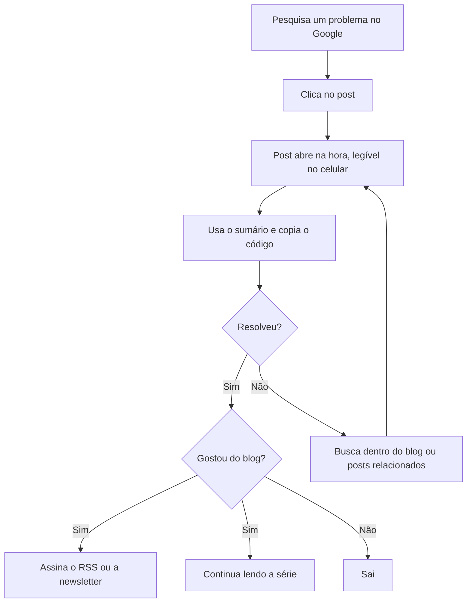
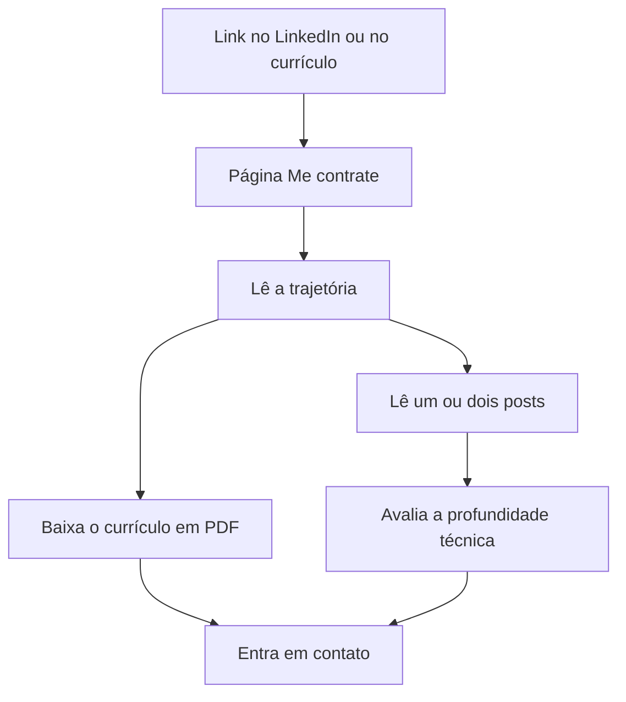
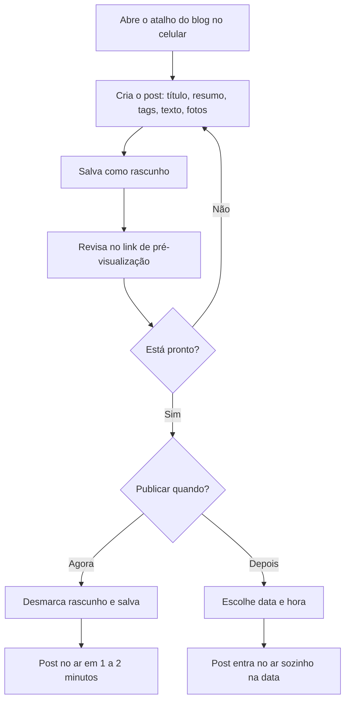
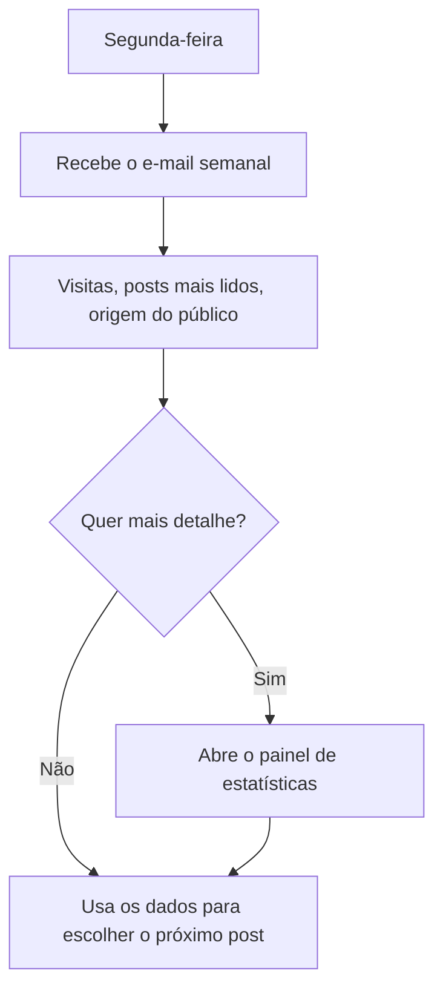

# PRD — Blog Felipe Braga

25/11/2026 · Felipe Braga

## Visão e objetivos

Um blog pessoal, em português, para desenvolvedores brasileiros, com o tema "Apenas um desenvolvedor resolvendo atividades de DevOps em um mundo com IA". O conteúdo é o produto; a página "Me contrate" existe como vitrine profissional, mas é secundária.

### Objetivos

1. **Ser encontrado**: posts aparecem bem no Google para buscas técnicas em português.
2. **Ser agradável de ler**: carrega instantaneamente no celular, visual minimalista e editorial, com faixas de cor pastéis.
3. **Ser fácil de manter**: o autor publica do celular ou do computador em poucos minutos, sem depender de ninguém.
4. **Saber o que funciona**: o autor recebe toda semana, por e-mail, quais posts foram lidos e de onde veio o público.
5. **Estar pronto para crescer**: a newsletter já nasce com o blog; comentários e anúncios pagos podem ser ligados depois, sem refazê-lo.
6. **Ser dono de tudo**: o conteúdo pertence ao autor e pode mudar de plataforma sem perder nada.
7. **Servir de case**: o código do blog é público e demonstra boas práticas, sem permitir que alguém se passe pelo autor.

## Público-alvo e personas

O público principal são devs brasileiros que chegam por busca procurando resolver um problema de DevOps, plataforma ou IA. As personas abaixo são hipóteses de partida, a validar com os dados de audiência.

| Persona | Quem é | Como chega | O que precisa |
| --- | --- | --- | --- |
| Dev buscando solução | Dev ou SRE com um problema concreto agora | Google, link compartilhado | Achar a resposta rápido, código que dá para copiar, ler bem no celular |
| Dev acompanhando | Quer aprender sobre DevOps com IA de forma contínua | RSS, newsletter, redes sociais | Saber quando sai post novo, séries organizadas |
| Recrutador ou contratante | Avalia o autor para uma vaga ou projeto | Link no LinkedIn ou currículo | Ver a trajetória e baixar o currículo em PDF |
| Autor (Felipe) | Escreve e mantém o blog sozinho | Celular ou computador | Publicar em minutos, acompanhar resultados sem esforço |

## Funcionalidades

O lançamento cobre ler, encontrar, assinar por RSS e newsletter, e publicar; o resto entra depois, sem retrabalho.

| Funcionalidade | Para quem | Quando |
| --- | --- | --- |
| Home com posts recentes | Leitor | Lançamento |
| Página de post com código formatado, imagens e sumário | Leitor | Lançamento |
| Tags e séries de posts | Leitor | Lançamento |
| Tempo de leitura e posts relacionados | Leitor | Lançamento |
| Página "Me contrate" com currículo e PDF | Recrutador | Lançamento |
| Feed RSS | Leitor recorrente | Lançamento |
| Newsletter por e-mail | Leitor recorrente | Lançamento |
| Escrever e publicar pelo celular e pelo computador | Autor | Lançamento |
| Rascunhos e publicação agendada | Autor | Lançamento |
| Estatísticas e e-mail semanal | Autor | Lançamento |
| Busca dentro do blog | Leitor | Depois |
| Comentários | Leitor | Futuro, com proteção contra spam |
| Pixels de anúncio Google/Meta e banner de cookies | Autor (promoção) | Quando for promover |
| Conteúdo interativo (diagramas, 3D) | Leitor | Por post, quando fizer sentido |

## Jornadas

### Leitor que chega pela busca

### Recrutador

### Autor publicando pelo celular

### Autor acompanhando resultados

## Regras de negócio

- **RN1**: Todo post tem título, resumo, data, pelo menos uma tag e, se tiver capa, texto alternativo. Sem isso, não publica.
- **RN2**: Rascunho nunca aparece no site, no RSS, no mapa do site nem na busca.
- **RN3**: Post agendado entra no ar em até 1 hora após a data escolhida.
- **RN4**: O endereço de um post publicado nunca muda; se precisar mudar, o antigo redireciona para o novo.
- **RN5**: O blog é todo em português.
- **RN6**: Nenhuma chamada para "Me contrate" fora da própria página; o foco do blog é o conteúdo.
- **RN7**: O blog não menciona a cidade do autor.
- **RN8**: Estatísticas básicas não usam cookies e não dependem do banner de consentimento.
- **RN9**: Pixels de anúncio só carregam depois que o visitante aceitar no banner de cookies; recusar não piora a leitura.
- **RN10**: Newsletter: inscrição só vale após confirmação por e-mail; formulário protegido contra bots; descadastro em um clique.
- **RN11**: Comentários (quando existirem): o autor pode ocultar ou excluir qualquer comentário; exigem login, passam por filtro anti-spam e o primeiro comentário de cada pessoa aguarda aprovação.
- **RN12**: O código pode ser copiado; nome, foto, logo, tagline e identidade visual não. O conteúdo dos posts segue a mesma licença do código (Apache-2.0): pode ser reaproveitado, desde que mantenha o crédito e o aviso de licença.
- **RN13**: Toda mudança no funcionamento do blog passa por testes automatizados antes de ir ao ar; publicar um post não depende deles.

## Métricas de sucesso

As métricas de qualidade têm meta desde o lançamento; as de audiência começam como linha de base nos três primeiros meses e ganham meta depois.

| Métrica | Meta | Onde ver |
| --- | --- | --- |
| Tempo para o conteúdo aparecer no celular | Menos de 1,5 s | Search Console (Core Web Vitals) |
| Nota de qualidade da página no celular | 95 ou mais | Lighthouse |
| Tempo para publicar um post pelo celular | Menos de 5 min | Uso real |
| Visitantes por semana | Linha de base | E-mail semanal |
| Visitas vindas de busca | Linha de base, crescendo mês a mês | Web Analytics e Search Console |
| Posts mais lidos e tempo de leitura | Linha de base | Web Analytics |
| Assinantes de RSS/newsletter | Linha de base | Base de inscritos da newsletter |

## Fora de escopo e questões em aberto

### Fora de escopo**

- Versão em outros idiomas.
- Contas de leitor, área logada ou conteúdo pago.
- Mais de um autor.
- Posts sobre homelab.
- Monetização (anúncios, patrocínio, cursos), por enquanto.
- Comentários no lançamento.

### Questões em aberto**

- [ ] Qual o endereço (domínio) definitivo?

Detalhes técnicos no [TRD](./trd.md).
