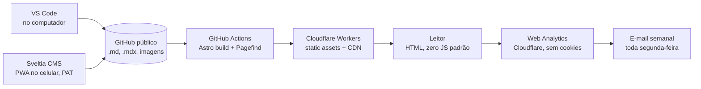
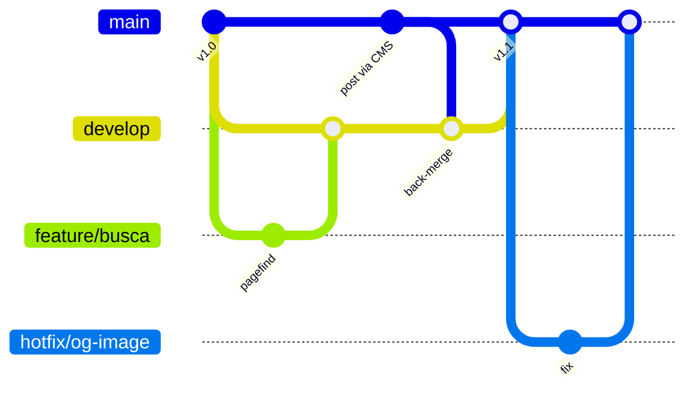

# TRD — Blog Felipe Braga

25/11/2026 · Felipe Braga

## Arquitetura

Site estático (SSG) gerado no build; o Git é a única fonte da verdade e não há servidor de aplicação nem banco no caminho do leitor. Requisitos de negócio no [PRD](./prd.md).



Todo commit, do PC ou do celular, dispara o build no Actions e o deploy no Cloudflare. O código dinâmico se resume a rotas do Worker: inscrição na newsletter e o cron do relatório semanal.

## Stack e decisões

| Camada | Tecnologia | Decisão | Alternativa descartada |
| --- | --- | --- | --- |
| Gerador | Astro 7 (SSG, Node 26 LTS) | Zero JS por padrão, Content Layer com Zod, MDX, imagens e RSS oficiais | Next.js (runtime React, imagens dependem de servidor) |
| Linguagem | TypeScript estrito (6.0.x) | Tipos do schema chegam aos templates; TS 7 ainda não é suportado pelo `astro check` nem pelo `typescript-eslint` | — |
| Pacotes | pnpm (versão fixada em `packageManager`) | Dependências estritas, sem dependências fantasma; scripts de instalação bloqueados por padrão | npm |
| Conteúdo | Markdown/MDX + frontmatter YAML no Git | Portável, versionado | Notion (lock-in, URLs de imagem expiram) |
| CMS | Sveltia CMS em `/admin`, login por PAT | Sem deploy próprio; PWA no celular | Decap, Pages CMS |
| Estilo | CSS nativo com custom properties (tokens da paleta) | Sem runtime; tokens no design | — |
| Fontes | Astro Fonts API, self-hosted | Fraunces, Instrument Sans, JetBrains Mono com preload | Google Fonts via CDN |
| Código nos posts | Shiki (build) | Realce sem JS | Prism no cliente |
| Diagramas | Mermaid renderizado no build | SVG estático | Mermaid no cliente |
| Busca | Pagefind | Índice estático | Algolia |
| CI/CD | GitHub Actions | Pipeline portável | Build integrado do host |
| Hospedagem | Cloudflare Workers Static Assets | **Aprovado** em 25/11 | Netlify, GitHub Pages |
| Analytics | Cloudflare Web Analytics | Grátis, sem cookies; e-mail semanal por Worker próprio | GA4 como principal |
| Pixels | GA4 + Meta Pixel atrás de consentimento e flag | Prontos, desligados | — |
| Licença | Apache-2.0 (código e conteúdo) + `BRAND.md` | Copiar sim, identidade não | MIT |

## Modelo de conteúdo

Não há banco de dados: o modelo são content collections do Astro, validadas por Zod no build. Um campo inválido quebra o build, não o site.

**Coleção `posts`** — `src/content/posts/<slug>/index.md(x)`

| Campo | Tipo | Obrigatório | Regra |
| --- | --- | --- | --- |
| `title` | string | Sim | Até 70 caracteres |
| `description` | string | Sim | 50–160 caracteres (vira meta description) |
| `publishDate` | datetime com fuso | Sim | Futuro = agendado |
| `updatedDate` | datetime | Não | Se ausente, vem do último commit do arquivo |
| `draft` | boolean | Não (padrão `false`) | `true` exclui de tudo |
| `tags` | referência[] → `tags` | Sim, mínimo 1 | Tag precisa existir |
| `series` | referência → `series` | Não | — |
| `seriesOrder` | number | Se `series` | — |
| `cover` | image() | Não | Processada pelo `astro:assets` |
| `coverAlt` | string | Se `cover` | — |
| `sectionColor` | enum (sálvia, céu, pêssego, manteiga, lavanda, rosa, menta) | Não | Cor da faixa/OG image |
| `canonical` | URL | Não | Para posts republicados de outro lugar |

### Coleções de apoio

- `tags` — `src/content/tags/*.yaml`: `name`, `description` (gera a página da tag).
- `series` — `src/content/series/*.yaml`: `name`, `description`.
- `pages` — páginas fixas em Markdown (ex.: "Me contrate").

**Valores derivados no build**: `slug` (pasta), URL `/blog/<slug>`, tempo de leitura, sumário (headings h2/h3), posts relacionados (tags em comum).

**Visibilidade**: `isPublished = !draft && publishDate <= agora_do_build`. Usado em todas as listagens, RSS, sitemap, Pagefind e rotas.

**Dados fora do Git**: inscritos da newsletter ficam numa tabela D1 `subscribers (email, status, token, created_at, confirmed_at)`; o envio é feito pelo Resend.

## Estrutura do repositório

Repositório público no GitHub; `main` é produção.

```text
.
├── .github/workflows/      # ci, deploy, preview, cron de publicação, back-merge, infra
├── docs/                   # documentação do projeto
│   ├── prd.md
│   ├── trd.md
│   └── adr/                # decisões de arquitetura, uma por arquivo
├── design/                 # arquivos de design (fontes do layout, exports, tokens)
├── infra/                  # Terraform: Cloudflare e GitHub
├── public/
│   ├── admin/              # Sveltia CMS: index.html + config.yml
│   ├── robots.txt
│   └── curriculo.pdf
├── src/
│   ├── content.config.ts   # schemas Zod das coleções
│   ├── content/
│   │   ├── posts/<slug>/   # index.md(x) + imagens do post
│   │   └── tags/  series/  pages/
│   ├── components/         # SEO, Picture, Callout, Terminal, ...
│   ├── layouts/            # Base, Post, Listagem
│   ├── pages/              # rotas, rss.xml.ts, feed.json.ts, og/[slug].png.ts
│   ├── styles/tokens.css   # paleta, tipografia, espaçamentos
│   └── lib/                # lógica em .ts (visibilidade, tempo de leitura, relacionados)
├── tests/
│   ├── unit/               # Vitest (src/lib)
│   ├── e2e/                # Playwright
│   └── fixtures/content/   # posts de teste, independentes dos posts reais
├── astro.config.ts
├── sonar-project.properties
├── wrangler.jsonc          # deploy Cloudflare (assets + headers)
├── LICENSE                 # Apache-2.0 (código e conteúdo)
├── BRAND.md                # identidade: todos os direitos reservados
└── README.md
```

`docs/` e `design/` ficam fora do build do site e excluídos da análise do Sonar. Os documentos em `docs/` são a versão versionada deste TRD e do PRD.

## Build, deploy e agendamento

O GitHub Actions faz todo o build; o Cloudflare só recebe `dist/`. Trocar de host = trocar o último job.

**Pipeline de deploy (`deploy.yml`, em push na `main`)**

1. Checkout, `pnpm/action-setup`, Node 26 LTS (`.nvmrc`), `pnpm install --frozen-lockfile`, cache do store do pnpm e de imagens processadas (`node_modules/.astro`).
2. `astro check` (tipos e schemas) e lint.
3. `astro build` → `dist/`.
4. `pagefind --site dist`.
5. Verificação de links internos e Lighthouse CI com orçamento (falha se cair abaixo da meta).
6. `wrangler deploy` (Workers Static Assets).
7. IndexNow com as URLs alteradas.

### Ambientes

| Ambiente | Gatilho | URL |
| --- | --- | --- |
| Local | `astro dev` | `localhost:4321` |
| Preview | Push em `develop`, `feature/*` ou PR | URL de versão do Worker (`wrangler versions upload`) |
| Produção | Merge na `main` ou commit de conteúdo pelo CMS | Domínio próprio |

**Agendamento**: `schedule` no Actions a cada hora dispara o mesmo pipeline; o filtro `isPublished` faz o resto. Plano B: Cron Trigger no Cloudflare chamando `workflow_dispatch`, caso o GitHub desative o agendamento após 60 dias sem atividade.

**Rascunhos no preview**: o build de preview usa `SHOW_DRAFTS=true` para exibir rascunhos e agendados; produção nunca.

**Redirects**: arquivo `_redirects` (ou regras no Worker) versionado; todo slug alterado ganha 301.

## Infraestrutura como código (Terraform)

Toda infraestrutura do GitHub e da Cloudflare é provisionada por Terraform em `infra/`; nada é configurado à mão no painel. O deploy do site em si continua com `wrangler deploy` no pipeline: Terraform cuida da infraestrutura, o pipeline cuida das versões do código.

- **`cloudflare/cloudflare`**: zona e registros DNS, domínio customizado e rotas do Worker, D1 (inscritos da newsletter), Email Routing e endereços verificados, widget Turnstile, Cron Triggers, site do Web Analytics, binding `send_email`, registros SPF/DKIM/DMARC do Resend, bucket R2 do state, regras de cache e segurança da zona.
- **`integrations/github`**: repositório e configurações, rulesets de `main` e `develop`, environments (`preview`, `production`, `infra-plan`, `infra`), variables do Actions (os secrets são criados à mão por environment, para não passarem pelo state), Discussions (para comentários no futuro), Dependabot e secret scanning.

### Organização

```text
infra/
├── bootstrap/      # aplicado uma vez, local: bucket R2 do state + token do CI
├── cloudflare/     # zona, DNS, Worker routes, D1, Email, Turnstile, Web Analytics
├── github/         # repo, rulesets, environments, secrets
└── modules/
```

- **State**: backend `s3` apontando para um bucket R2 (compatível com S3), criptografado, um state por pasta. Locking a validar no R2; alternativa: HCP Terraform no plano gratuito.
- **Versões**: Terraform e providers fixados (`required_version`, `.terraform.lock.hcl` versionado).
- **Pipeline (`infra.yml`)**: em PR com mudança em `infra/`, roda `fmt -check`, `validate`, `tflint`, `trivy config` e `plan`, com o plano comentado no PR; no merge na `main`, o plano é salvo e um único `apply` o aplica no environment `infra` com aprovação manual. O `production` não tem aprovação: é o que o deploy do site e os commits de conteúdo do CMS usam, e eles precisam ir ao ar em minutos.
- **Segredos**: tokens da Cloudflare e do GitHub (fine-grained, escopo mínimo) só em secrets de environment do GitHub (`production`, `preview`, `infra-plan`, `infra`), um token por função e nunca secrets de repositório; jobs que executam código do projeto (build, dependências) não recebem nenhum; nada sensível em `.tfvars` versionado.
- **Galinha e ovo**: `bootstrap/` roda uma vez localmente para criar o bucket do state e os tokens do CI; depois tudo passa pelo pipeline.
- **Drift**: `plan` agendado semanal; diferença abre uma issue.

## Fluxo Git (git flow simplificado)

Código segue git flow sem branches de release; conteúdo publicado pelo CMS vai direto para a `main`, porque passar posts por `develop` impediria publicar pelo celular.



- **`main`**: produção. Recebe merge de `develop` e `hotfix/*` por PR com quality gate verde, e commits de conteúdo do Sveltia.
- **`develop`**: integração; cada push publica no ambiente de preview.
- **`feature/*`**: sai de `develop`, volta por PR.
- **`hotfix/*`**: sai de `main`, volta por PR para `main`; o back-merge leva para `develop`.
- **Back-merge automático**: workflow que, a cada push na `main`, faz merge de `main` em `develop` (traz posts e hotfixes).
- **Versão**: tag SemVer na `main` a cada merge de `develop` (`v1.2.0`); posts não geram versão.
- **Commits**: Conventional Commits (`feat:`, `fix:`, `content:`, `docs:`); o Sveltia usa `content:` no template de mensagem.
- **Proteção**: `main` e `develop` sem force-push; PRs exigem CI e quality gate. Commits de conteúdo na `main` passam por bypass do administrador (você).

## Testes e quality gate

Três camadas de teste e o SonarQube Cloud como portão de qualidade. Mudanças só em `src/content/posts/**` pulam e2e e Sonar, mas mantêm build, `astro check` e verificação de links.

| Camada | Ferramenta | O que cobre | Quando roda |
| --- | --- | --- | --- |
| Unitário | Vitest | `src/lib` (visibilidade/agendamento, tempo de leitura, relacionados, slugs) e schemas Zod | Todo PR e push |
| E2E | Playwright (Chromium + WebKit mobile) | Home, post, tag, série, "Me contrate", 404, busca, copiar código, RSS e sitemap válidos, `/admin` carrega, rascunho não aparece, agendado só após a data, inscrição na newsletter | PR e push em `develop`/`main` com mudança de código |
| Visual | Playwright screenshots | Templates com posts de `tests/fixtures`, nas cores das faixas | Junto com e2e |
| Acessibilidade | `@axe-core/playwright` | Zero violações sérias por template | Junto com e2e |
| Performance/SEO | Lighthouse CI | Orçamentos do RNF1–RNF3 | Todo deploy |

**Por que fixtures**: os e2e rodam sobre posts de teste em `tests/fixtures/content`, então post novo não quebra teste e teste não depende de post real.

### SonarQube Cloud (plano gratuito)

- Gratuito para repositórios públicos, sem limite de linhas; análise de PR com comentário no GitHub.
- Análise via GitHub Action no CI (não a automática), para enviar cobertura do Vitest em `lcov`.
- Quality gate "Sonar way" no código novo: cobertura ≥ 80%, duplicação ≤ 3%, zero bugs e vulnerabilidades novas, hotspots revisados.
- Limitação: o Sonar não analisa arquivos `.astro`. Regra do projeto: lógica vai em `.ts` (`src/lib`, scripts de componentes); `.astro` fica só com marcação.
- Exclusões: `docs/`, `design/`, `infra/`, `src/content/`, `tests/fixtures/`, `public/admin/`.

**CI (`ci.yml`, em PR e push em `develop`)**

1. Filtro de caminhos: só conteúdo? Pula 4 e 5.
2. Lint, `astro check`, Vitest com cobertura.
3. `astro build` + Pagefind + verificação de links.
4. Playwright (e2e, visual, axe) contra o `dist/` servido localmente.
5. SonarQube Cloud + quality gate (bloqueia merge se falhar).
6. Deploy de preview.

## Performance, cache e imagens

### Cache (headers no Worker)

| Caminho | `Cache-Control` | Motivo |
| --- | --- | --- |
| `/_astro/*` (JS, CSS, imagens e fontes com hash; as fontes ficam em `/_astro/fonts/`) | `public, max-age=31536000, immutable` | Nome muda a cada versão |
| HTML, `rss.xml`, `sitemap*.xml` | `public, max-age=0, must-revalidate` | Sempre a versão atual após deploy |
| `/pagefind/*` | `public, max-age=3600` | Índice muda a cada build |

**JavaScript**: nenhum por padrão. Ilhas só onde necessário, com `client:visible` ou `client:idle` (busca, copiar código, Giscus, cenas 3D).

**Fontes**: Astro Fonts API, WOFF2 self-hosted, subset latino, `preload` só dos pesos usados acima da dobra, `font-display: swap` com fallback ajustado para evitar CLS.

**CSS**: tokens em custom properties, CSS crítico inline pelo Astro, sem framework de UI.

**Imagens (`astro:assets` + Sharp)**

- `<Picture>` com AVIF e WebP, fallback JPEG; encoders configurados globalmente.
- Larguras 400, 800, 1200, 1600 px; `sizes` conforme a coluna de texto.
- `width`/`height` sempre emitidos.
- Capa: `loading="eager"` + `fetchpriority="high"`; demais: `lazy` + `decoding="async"`.
- EXIF removido; uploads do celular já chegam em WebP e redimensionados pelo Sveltia.
- SVG otimizado com SVGO; Mermaid vira SVG no build.
- Cache das imagens processadas entre builds no Actions.

## SEO técnico

Tudo sai de um componente `<SEO>` no layout base, alimentado pelo frontmatter.

- **Head**: `lang="pt-BR"`, `<title>`, meta description, canonical, `og:*`, `twitter:card=summary_large_image`, link de autodescoberta do RSS e do JSON Feed.
- **JSON-LD**: `BlogPosting` (headline, datas, autor, imagem, `inLanguage`), `Person` com `sameAs` (GitHub, LinkedIn) e `BreadcrumbList`.
- **OG images**: endpoint `og/[slug].png.ts` no build com Satori + Sharp, Fraunces e a `sectionColor` do post.
- **Sitemap**: `@astrojs/sitemap` com `lastmod` do último commit; só páginas `isPublished`; sem `priority`/`changefreq`.
- **robots.txt** apontando o sitemap; `/admin` e previews com `noindex`.
- **URLs**: `/blog/<slug>`, `/tags/<tag>`, `/series/<serie>`; sem data no caminho, sem barra final duplicada.
- **Feeds**: `rss.xml` (conteúdo completo) e `feed.json`; `llms.txt` com índice dos posts.
- **Indexação**: Search Console e Bing Webmaster com sitemap; IndexNow no deploy.
- **HTML**: um `h1` por página, headings em ordem, `alt` obrigatório via schema.

## Integrações

| Integração | Como liga | Carregamento | Fase |
| --- | --- | --- | --- |
| Sveltia CMS | `public/admin` + `config.yml` espelhando o schema; backend GitHub; login por PAT fine-grained; mídia em `src/content/posts/<slug>/` com otimizador WebP ligado | Só em `/admin` | Lançamento |
| Cloudflare Web Analytics | Beacon JS da Cloudflare em todas as páginas; site criado via Terraform. Mede visitas, páginas, origens e Web Vitals; não registra eventos personalizados (leitura 75%, download do currículo) | `defer`, sem cookies | Lançamento |
| Relatório semanal | Worker com Cron Trigger semanal (segunda, 8h) consulta a GraphQL Analytics API (`rumPageloadEventsAdaptiveGroups`) e a API do Search Console, monta o resumo e envia pelo binding `send_email` para seu endereço verificado (grátis) | — | Lançamento |
| Newsletter | Rota `/api/subscribe` no Worker + D1; Turnstile, honeypot e rate limit; double opt-in; envio pelo Resend (confirmação, boas-vindas e posts novos via RSS) | Form estático | Lançamento |
| Pagefind | Passo após o build; `data-pagefind-body` só no corpo do post | JS ao abrir a busca | Depois |
| Giscus | GitHub Discussions (exige login GitHub); moderação e bloqueio pelo GitHub; categoria por post | Ao rolar até o fim | Futuro |
| Banner de consentimento | vanilla-cookieconsent, categorias análise e marketing | Só com flag ligada | Quando promover |
| GA4 + Meta Pixel | Consent Mode v2; carregam após aceite, opcionalmente via Partytown; flag `PUBLIC_ENABLE_ADS_PIXELS` | Após aceite | Quando promover |
| Three.js / cenas interativas | Componente ilha em `.mdx`, `client:visible` | Só na página que usa | Por post |

## Segurança e licenças

Repositório público: tudo no Git é visível (inclusive rascunhos e histórico); segredos ficam só em GitHub Secrets e variáveis do Worker.

### Repositório e CI

- [ ] `.gitignore`: `.env`, `.env.*`, `.dev.vars`, `.wrangler/`, `.terraform/`, `*.tfstate*`
- [ ] Secret scanning, push protection e Dependabot ativos
- [ ] Segredos: `CLOUDFLARE_API_TOKEN` (escopo mínimo), `RESEND_API_KEY`, token de leitura da API de Analytics da Cloudflare
- [ ] Workflows com `permissions: contents: read` por padrão
- [ ] Actions de terceiros fixadas por SHA
- [ ] `main` protegida contra force-push e exclusão
- [ ] 2FA no GitHub e na Cloudflare
- [ ] Currículo PDF sem telefone, endereço ou documentos

### Aplicação

- [ ] PAT do Sveltia fine-grained: só este repo, "Contents: read and write", validade de 90 dias
- [ ] Só variáveis `PUBLIC_` no código do site (Astro 7 embute `import.meta.env` no build). Única exceção: `SHOW_DRAFTS`, definida só no build de preview (nunca na produção) para exibir rascunhos e agendados
- [ ] CSP do Astro 7 com hashes; exceções só para Cloudflare Web Analytics, Giscus e pixels quando ligados
- [ ] Headers: HSTS, `X-Content-Type-Options: nosniff`, `Referrer-Policy: strict-origin-when-cross-origin`, `Permissions-Policy`
- [ ] Endpoints (newsletter): validação, rate limit, Turnstile
- [ ] EXIF removido das imagens

### Licenças

| Camada | Licença | Arquivo |
| --- | --- | --- |
| Código | Apache-2.0 | `LICENSE` |
| Identidade (nome, foto, logo, tagline, paleta + tipografia) | Todos os direitos reservados | `BRAND.md` |
| Conteúdo | Apache-2.0 (mesma do código) | `LICENSE` |

## Requisitos não funcionais

| # | Requisito | Critério de aceite | Verificado por |
| --- | --- | --- | --- |
| RNF1 | Performance | LCP < 1,5 s, CLS < 0,05, INP < 200 ms no mobile; Lighthouse ≥ 95 | Lighthouse CI no pipeline |
| RNF2 | Peso da página de post | HTML+CSS+fontes < 150 KB sem imagens; 0 KB de JS obrigatório | Orçamento no Lighthouse CI |
| RNF3 | SEO | Lighthouse SEO = 100; sitemap e feeds válidos | Lighthouse CI, W3C Feed Validator |
| RNF4 | Acessibilidade | Lighthouse a11y ≥ 95; contraste AA nas faixas pastéis | Lighthouse CI, revisão manual |
| RNF5 | Integridade do conteúdo | Frontmatter inválido falha o build | `astro check` |
| RNF6 | Links | Zero links internos quebrados | Verificador no pipeline |
| RNF7 | Tempo de build | < 3 min com cache | Duração do job |
| RNF8 | Portabilidade | Deploy em outro host estático trocando só o job final | Teste de deploy alternativo |
| RNF9 | Disponibilidade | Servido por CDN; sem servidor de aplicação no caminho crítico | Arquitetura |
| RNF10 | Privacidade | Analytics sem cookies; pixels só com consentimento | Revisão de headers e cookies |
