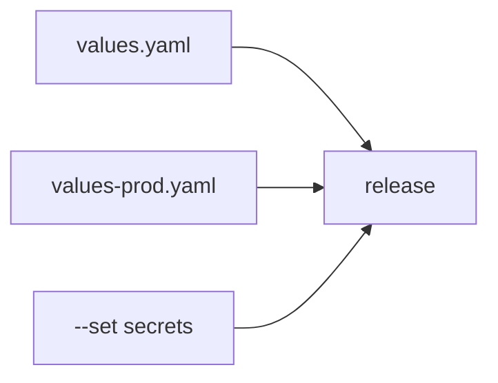

<Tldr>

- Um `values.yaml` base com defaults seguros, e um arquivo pequeno por ambiente.
- Segredos entram em tempo de deploy, nunca no chart.
- Rode `helm template` + schema no CI antes de qualquer `upgrade`.

</Tldr>

Todo time que adota Helm passa pela mesma fase: um `values-prod.yaml` que começou como cópia do de staging e, seis meses depois, ninguém sabe dizer o que mudou entre eles. Este texto é sobre sair dessa fase[^1].

## Um values por camada

A ideia é simples: o arquivo base descreve o serviço; os arquivos de ambiente descrevem _só a diferença_. Se um override tem mais de vinte linhas, provavelmente é configuração do serviço disfarçada.

```yaml title="charts/api/values-prod.yaml" {4}
# só o que difere da base
replicaCount: 3
image:
  tag: '1.8.2'
resources:
  limits:
    memory: 512Mi
autoscaling: { enabled: true }
```

<Callout type="nota">
  A ordem dos `-f` importa: o último arquivo vence. Base primeiro, ambiente
  depois.
</Callout>

<Callout type="dica">
  Use `helm get values --all` para ver o resultado final de um release.
</Callout>

<Callout type="atencao">
  Um `--set` na linha de comando sobrescreve qualquer arquivo de values.
</Callout>

<Callout type="perigo">
  Nunca versione um `Secret` com o valor em texto puro, nem comentado.
</Callout>

### Segredos fora do repo

Três regras que evitam a maior parte dos incidentes:

1. O chart referencia um `Secret` existente pelo nome.
2. Quem cria o segredo é o pipeline ou o External Secrets, não o chart.
3. Nenhum valor sensível em `values-*.yaml`, nem comentado.

> Configuração boa é a que você consegue ler num diff de pull request sem abrir outro arquivo.

Um comando para conferir o que será aplicado, com uma linha bem longa para forçar a rolagem horizontal do bloco:

```bash
helm upgrade api ./charts/api -f values.yaml -f values-prod.yaml --set image.tag=1.8.2 --atomic --timeout 5m --namespace producao --create-namespace
```



<Figure
  src="./helm-diff.png"
  alt="Saída do helm diff: réplicas de 2 para 3, imagem de 1.8.1 para 1.8.2 e novo limite de memória de 512Mi"
  caption="Figura 1 — helm diff upgrade com base + produção."
/>

Antes de aplicar, o `helm diff` mostra exatamente o que cada camada muda no cluster:

<Figure
  src="./helm-diff.png"
  alt="Saída do helm diff em largura estendida, com os mesmos três valores alterados"
  caption="Figura 2 — a mesma saída, em largura estendida."
  wide
/>

## Validando antes do deploy

| Verificação       | Ferramenta           | Quando roda         | Falha o pipeline |
| ----------------- | -------------------- | ------------------- | ---------------- |
| Renderização      | `helm template`      | A cada pull request | Sim              |
| Schema dos values | `values.schema.json` | A cada pull request | Sim              |
| Diferença         | `helm diff`          | Antes do `upgrade`  | Não              |

Com isso no lugar, o próximo passo é [validar o resultado renderizado no CI](/blog/primeiro-post)[^2], antes de qualquer cluster ver o manifesto.

```
bloco sem título e sem linguagem
```

[^1]: Se você ainda não chegou nela, guarde este link para daqui a seis meses.

[^2]: O segundo rodapé existe para provar que a lista tem mais de um item.
